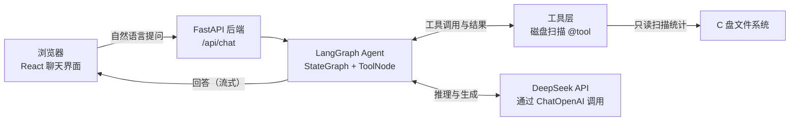

# CCLEAR 项目设计文档

> C 盘清理 · 空间分析 · 网页版 AI Agent
> 版本：v0.1（设计稿）｜状态：待确认后开始 Phase 1

---

## 1. 项目一句话介绍

**CCLEAR 是一个跑在本机的网页版 AI Agent：你用自然语言问"C 盘什么占地方"，它帮你扫描、分析、给出透明的清理建议——先分析后建议，绝不偷偷动你的文件。**

### 目标（三个都要）

| 目标 | 说明 |
| --- | --- |
| 真实可用 | 真的能帮人看清 C 盘、找到垃圾、释放空间 |
| 学习 Agent 开发 | 从最基础开始，每阶段代码都能讲明白，理解 Agent 原理 |
| 找工作 | 一个能写进简历、面试能讲 20 分钟的项目 |

### 面试话术预览（最终版到简历阶段再打磨）

> "我做了一个本地运行的 C 盘清理 Web Agent。前端 React，后端 FastAPI，用 LangGraph 编排 Agent，DeepSeek 做推理。工具层提供目录扫描、大文件查找、垃圾目录识别等能力，模型通过 Tool Calling 自主决定调用哪个工具、传什么参数。所有操作只读优先，删除必须人工确认（human-in-the-loop）。进阶版我把工具层封装成了 MCP Server，与 Agent 解耦。"

---

## 2. 为什么做它（和 360 / 腾讯管家有什么不同）

传统清理软件（360、腾讯管家、金山毒霸）的问题：

- **黑盒**：扫了什么、删了什么，说不清楚
- **广告与捆绑**：清理是钩子，卖会员、装全家桶才是目的
- **需要"信任"**：只能相信它的"一键清理"，不知道具体删了什么

CCLEAR 的差异点：

1. **透明**：每一个结论都有数据支撑（哪个目录多大、哪些是常见垃圾），先出分析报告，再谈清理
2. **对话式**：不用在一堆按钮里找功能，直接问："C 盘为什么红了？""D 盘的下载文件夹能清吗？"
3. **可控**：Agent 只负责分析和建议；任何删除动作必须用户看到清单后明确确认，**没有"一键偷偷删"**

一句话：**传统软件替你决定，CCLEAR 帮你理解，你自己决定。**

---

## 3. 技术栈与选型理由

| 层 | 选型 | 为什么是它 |
| --- | --- | --- |
| 前端 | React + Vite + TypeScript | 招聘岗位最多；Vite 启动快；TS 有类型提示，AI 生成的代码更好维护 |
| 后端 | Python 3.13 + FastAPI | Agent/LLM 生态以 Python 为主；FastAPI 轻量、异步、自带接口文档（localhost:8000/docs 可直接调试） |
| 大模型 | DeepSeek（OpenAI 兼容接口） | 国内直连、价格便宜、支持 Function Calling；用 `langchain-openai` 的 `ChatOpenAI` 指向它，随时可换其他兼容模型 |
| Agent 框架 | LangChain + LangGraph | 当前主流；LangGraph 的图结构能清晰表达"模型思考 → 调工具 → 再看结果"的循环；支持 `interrupt` 做人工确认 |
| 工具协议 | 先普通 `@tool`，进阶再上 MCP | MCP 是 2025 起的事实标准，面试加分项，放到 Phase 7 作为"解耦升级" |

运行环境已确认：Node v24 / Python 3.13 / npm 11.19。

---

## 4. 总体架构



关键理解：**模型本身不能执行任何代码**。它只会"说"我要调用哪个工具、参数是什么；真正去扫磁盘的是我们写的 Python 函数（工具层）。Agent 循环就是把"模型的意图 → 工具的真正的执行 → 结果回给模型 → 模型继续"串起来的那个圈。

---

## 5. 分阶段路线图（从简到难）

> 原则：每个阶段都小到能一次讲明白。每完成一个阶段，先讲解代码，你确认之后再进入下一阶段。
> 每个阶段格式：**做什么 → 你会学到什么 → 怎么验收**。

### Phase 1：最小骨架（不接 AI）

- **做什么**
  - 用 Vite 初始化 React + TS 前端，做一个聊天界面（消息列表 + 输入框）
  - FastAPI 提供 `POST /api/chat`，先返回固定文字（如"收到，我还在学习中"）
  - 解决前后端通信与跨域（CORS）
- **你会学到**：前后端分离架构、HTTP 请求、CORS、项目目录组织
- **验收**：浏览器里发消息，能收到后端的固定回复

### Phase 2：接入 DeepSeek，真正对话

- **做什么**
  - 后端用 `langchain-openai` 的 `ChatOpenAI`，指向 DeepSeek 的兼容接口
  - System Prompt 定义人设（"你是 CCLEAR，一个透明的 C 盘清理助手……"）
  - API Key 放在 `.env`，支持流式输出（打字机效果）
- **你会学到**：LLM API 调用、System Prompt 的作用、Token 概念、流式输出（Streaming/SSE）
- **验收**：聊天框能正常对话，回答是逐字流式出现的

### Phase 3：第一个工具 + Agent 循环（核心学习点）

- **做什么**
  - 用 `@tool` 定义第一个工具：`scan_directory_size(path)` —— 统计指定目录的大小
  - 加安全限制：限制扫描深度、超时、只扫描白名单范围
  - 用 LangGraph 组织工具调用循环（`StateGraph` + `ToolNode`，或先体验预构建的 ReAct agent 再拆开看）
- **你会学到**：Tool Calling / Function Calling 的原理、工具描述（description）怎么写模型才会用好、ToolNode、ReAct 循环、`recursion_limit` 防死循环
- **验收**：问"帮我看看 C 盘用户目录下哪个文件夹最大"，聊天里能看到工具被调用、参数是什么、结果是什么，最后模型基于结果回答

### Phase 4：C 盘工具集，组合调用

- **做什么**
  - 增加工具：常见垃圾目录识别（Temp、缓存、回收站、Windows.old、休眠文件等，只统计不删除）、大文件 Top 20、文件夹大小排行
  - 优化扫描性能（os.scandir、并发、缓存）
  - 让 Agent 能在一个问题里串起多个工具
- **你会学到**：多工具设计、工具描述对模型决策的影响、工具组合、扫描性能优化
- **验收**：一句"帮我全面分析下 C 盘哪里占地方"，Agent 自动连续调用多个工具给出综合结论

### Phase 5：清理建议报告 + 人工确认（安全底线）

- **做什么**
  - Agent 输出结构化报告：垃圾分类 → 各自大小 → 风险等级（安全 / 谨慎 / 不建议）
  - 删除动作必须 human-in-the-loop：前端弹出清单和"确认删除"按钮（LangGraph `interrupt`）
  - 删除功能最后做，且先在小范围（如回收站、专门建的测试目录）验证
- **你会学到**：Human-in-the-loop、LangGraph interrupt、安全边界设计、结构化输出（让模型输出 JSON）
- **验收**：Agent 给出分类报告；尝试删除时一定会弹出确认，不确认不执行

### Phase 6：界面与可视化

- **做什么**
  - 磁盘占用图表（饼图 / 条形图）、工具调用过程可视化（"正在扫描 xxx…"时间线）
  - 整体 UI 美化（深色主题、动画）
- **你会学到**：前端数据可视化、把 Agent 的中间事件渲染成 UI
- **验收**：界面好看、过程可见、体验顺畅

### Phase 7（可选进阶）：MCP 化 + 记忆 + 深入原理

- **做什么（任选组合）**
  - **MCP 化**：把磁盘工具封装成独立 MCP Server，Agent 通过 `langchain-mcp-adapters` 作为 MCP Client 接入；还可演示"Cursor / Claude Desktop 复用我的工具"
  - **对话记忆**：LangGraph checkpointer，多轮对话记住上下文
  - **多轮规划**：复杂任务先出计划再执行
  - **手写 mini loop**：不用框架手写一遍工具循环，对比理解 LangGraph 底层在做什么
- **你会学到**：MCP 协议、工具解耦、持久化记忆、Agent 框架底层原理
- **验收**：至少完成 MCP 化，能讲清"工具和 Agent 为什么应该解耦"

---

## 6. 安全原则（贯穿全程，不可妥协）

1. **只读优先**：Phase 1-4 完全不提供删除能力，只扫描、只统计
2. **扫描范围限制**：默认只扫用户目录与常见垃圾位置，不碰系统关键目录（System32 等）
3. **删除必须人工确认**：任何删除动作先展示清单 → 用户点击确认 → 才执行；没有"一键全自动清理"
4. **不上传用户数据**：文件内容不出本机；发给大模型的只有路径、大小这类元数据
5. **密钥安全**：DeepSeek API Key 只放 `.env`，不进代码、不进 git

---

## 7. 名词小抄（面试前看这个）

| 名词 | 大白话解释 |
| --- | --- |
| LLM | 大语言模型，本质是"根据上文预测下一个词"的模型，DeepSeek 就是其中一个 |
| Prompt | 给模型的输入文本 |
| System Prompt | 系统设定，告诉模型"你是谁、该怎么表现"，每轮对话都带着 |
| Token | 模型处理文本的最小单位，计费和上下文长度的单位 |
| Tool Calling（Function Calling） | 模型输出"我要调用某工具、参数是这些"的结构化意图；真正执行的是你的代码 |
| Agent Loop | "模型思考 → 调工具 → 把结果给模型 → 继续思考"的循环，直到模型给出最终回答 |
| ReAct | Reason + Act 范式：模型先推理、再行动（调工具）、观察结果、循环往复 |
| LangGraph | 用图（节点 + 边）编排 Agent 流程的框架，能清晰表达循环和条件分支 |
| Checkpointer | LangGraph 的记忆机制，把每步状态存下来，支持多轮对话 |
| Human-in-the-loop | 让人类介入关键步骤（如删除确认），LangGraph 用 `interrupt` 实现 |
| Streaming / SSE | 流式输出，模型边生成边显示（打字机效果），基于 Server-Sent Events |
| MCP | Model Context Protocol，Agent 与外部工具/数据源之间的标准协议，工具与 Agent 解耦 |

---

## 8. 目录结构规划

```text
Cclear/
├─ docs/
│  └─ 项目设计文档.md        # 本文档
├─ backend/
│  ├─ app/
│  │  ├─ main.py             # FastAPI 入口（Phase 1）
│  │  ├─ config.py           # 配置与 .env 加载（Phase 2）
│  │  ├─ agent/              # LangGraph Agent 定义（Phase 3 起）
│  │  └─ tools/              # 磁盘扫描工具（Phase 3 起）
│  ├─ .env                   # API Key 等（不进 git）
│  └─ requirements.txt
├─ frontend/
│  ├─ src/
│  │  ├─ App.tsx             # 聊天主界面（Phase 1）
│  │  └─ components/         # 消息气泡、输入框、图表等（Phase 1/6）
│  └─ package.json
└─ README.md
```

---

## 9. 下一步

Phase 1 启动内容：后端 `/api/chat` 返回固定文字 + 前端聊天框，跑通"能聊天"的最小骨架。确认本文档后即可开始。
